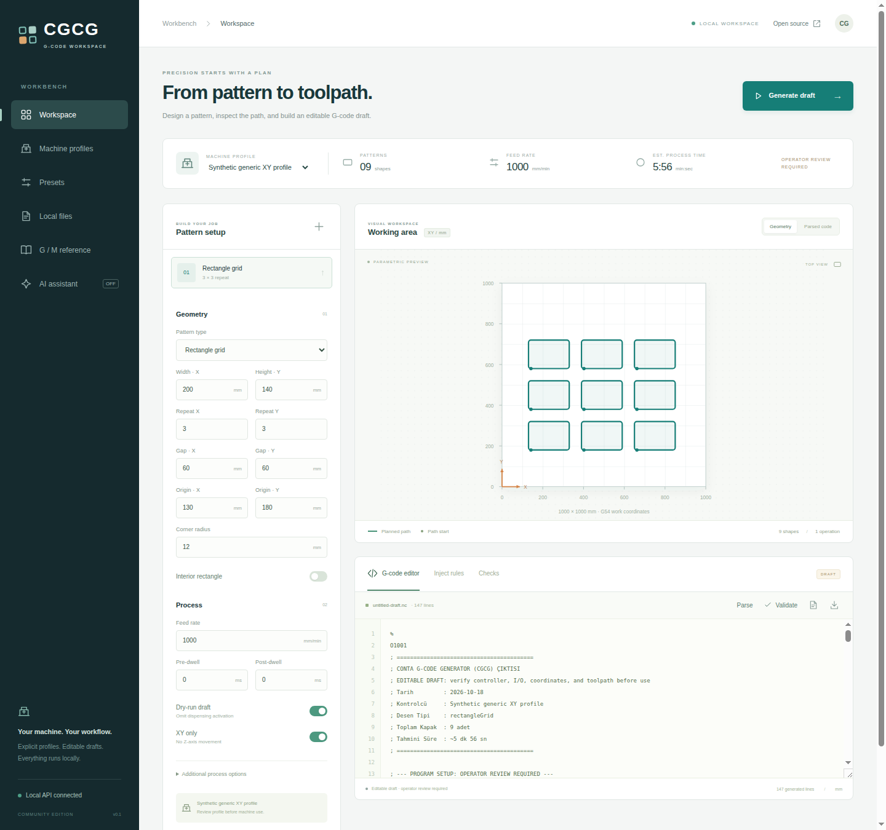

# CGCG

**A local, profile-driven G-code workbench.**

Generate parametric paths, inspect and edit G-code, apply explicit process
injections, compare nominal XY previews, and keep machine profiles, presets and
files in a local workspace. No connection to a physical controller is made.



[Mobile screenshot](docs/assets/workspace-mobile.png) · [Synthetic path gallery](docs/EXAMPLES.md)

## Quick start

Use **Node.js 24 or newer**:

```bash
git clone https://github.com/ufukefekaya-tr/cgcg.git
cd cgcg
npm ci
cp .env.example .env
npm run build
npm start
```

The server binds to `127.0.0.1:4310` by default and serves the built UI. For
frontend development, use `npm run dev`. See `.env.example` for explicit local
configuration. Runtime data is created in a new local data directory and is
excluded from source control. Only fictional demonstration profiles are seeded.

## Workflow

1. Select and review a machine profile, units, axes, coordinate system and I/O
   mappings. Example profiles are illustrative, not physically qualified.
2. Define rectangle grids, circles, linear paths or an ordered multi-geometry job.
3. Generate a draft program; inspect the code and nominal XY path.
4. Review syntax, soft-limit and process findings. These checks have explicit
   scope and do not prove a program is safe for a real machine.
5. Save a preset, edit/inject deliberately, and download the reviewed draft.

Two-axis generation excludes Z moves. Unknown controller names fail explicitly.
Machine-zero moves require an explicitly configured, operator-verified command;
there is no universal homing sequence. Controller dialects and valve/spindle
mappings are machine-specific. Never run a demonstration profile on hardware
without controller-specific review, simulation and commissioning.

## Features

- Rectangle grids, circular paths, linear paths and ordered geometry entries.
- Parser/serializer, editable G-code and nominal work-coordinate preview.
- Explicit feed, dwell, valve/process and safe-height injection operations.
- Profile, preset and text-file management using a fresh local SQLite store.
- Local API with bounded input, uploads and browser-origin controls.
- Optional Gemini vision assistance, disabled by default. Enabling it requires
  explicit configuration and the operator's credentials/model choice; no AI
  service is needed for geometry generation, editing or tests.

The UI preview is a nominal geometric aid, not a controller emulator, stock
simulation, collision solver or physical toolpath certification.

See [four reproducible synthetic programs and path images](docs/EXAMPLES.md).

## Source recovery

The previous installation contained readable deployed backend ES modules but no
TypeScript/React checkout or source maps. The engine was recovered into source
with recorded fingerprints; this public React interface is newly reconstructed
from the documented workflow. No minified application bundle is presented as
original source. See [recovery and changes](docs/RECOVERY.md).

Production environments, SQLite files, customer jobs, uploaded files, real
machine settings and old repository history are excluded. All screenshots and
demonstration data in this repository are newly produced from synthetic inputs.

## Development

```bash
npm run check
npm test
npm run build
```

Tests use synthetic geometry, local temporary databases and mocked integrations.
They do not command hardware or call a live AI provider. Third-party libraries
retain their own licenses; see NOTICE and THIRD_PARTY_LICENSES.txt.

## License

Copyright **2026 Ufuk Efe Kaya**. Original source, reconstructed UI, synthetic
examples, documentation and screenshots are available under **MIT OR Apache-2.0**,
at your option. See LICENSE, LICENSE-MIT, LICENSE-APACHE and NOTICE.
