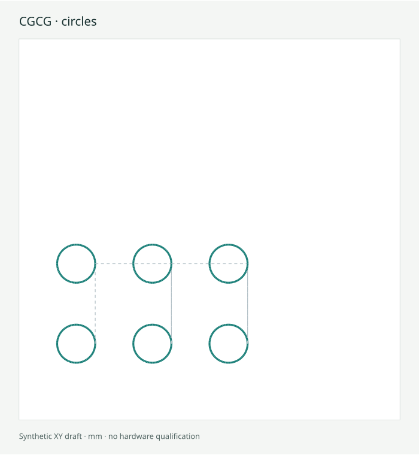
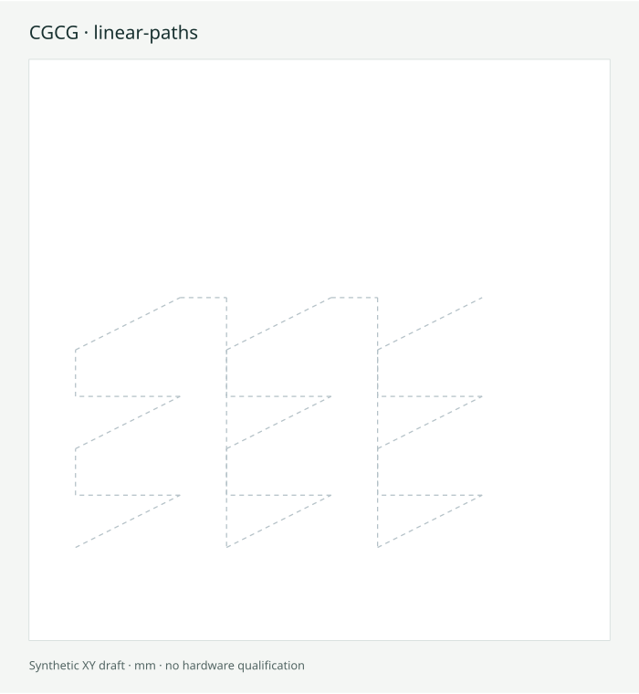
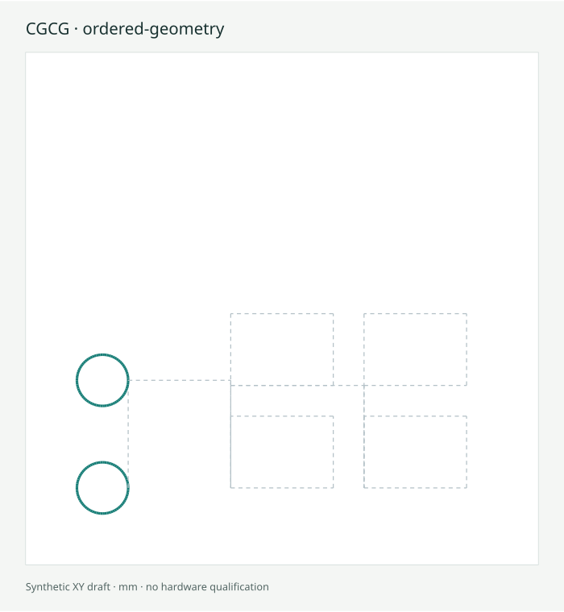

# Synthetic examples

These programs and images are newly produced from fictional millimetre profiles.
They are drafts for inspection, not controller-qualified machine programs. Process
outputs are disabled in the sample requests. The first approach from an unknown
physical position is deliberately not drawn.

| Pattern | Nominal XY output | Request | Generated draft |
| --- | --- | --- | --- |
| Rectangle grid |  | [JSON](../examples/rectangle-grid.json) | [G-code](../examples/rectangle-grid.nc) |
| Circles |  | [JSON](../examples/circles.json) | [G-code](../examples/circles.nc) |
| Linear paths |  | [JSON](../examples/linear-paths.json) | [G-code](../examples/linear-paths.nc) |
| Ordered geometry |  | [JSON](../examples/ordered-geometry.json) | [G-code](../examples/ordered-geometry.nc) |

Regenerate from the engine with `node scripts/generate-examples.js`. The script
checks every generated draft against the declared static validation subset and
writes SHA-256 request/program fingerprints to `examples/manifest.json`. Dashed
segments are nominal rapid moves; solid segments are nominal feed paths.

The generated header records the generation date; regenerating on a different
day updates that header and the corresponding fingerprints.
